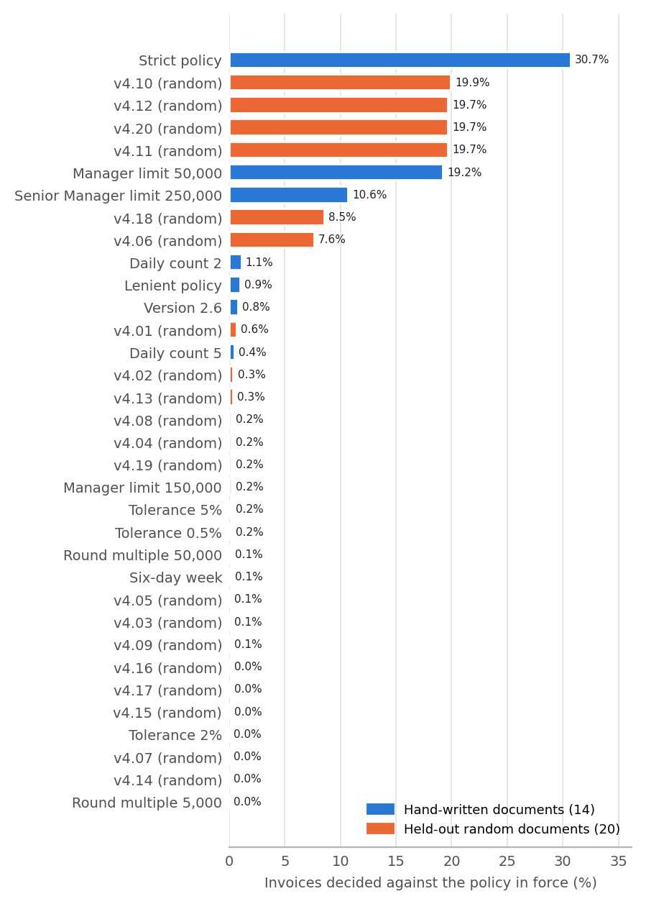
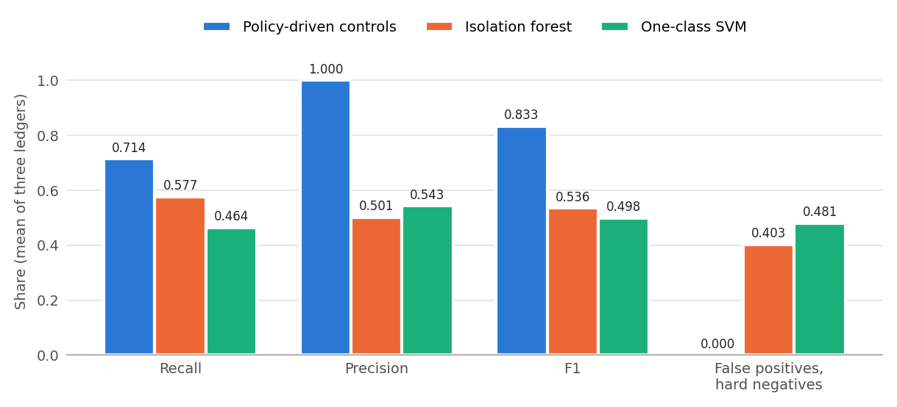
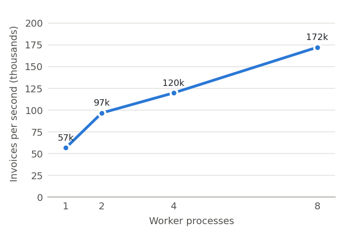

# AuditIQ: results for the paper

This is the one document to read while writing the paper. It collects every
result the project has measured, with the table or figure to use, the file the
number comes from, and the script that wrote that file. Paths are relative to
`auditiq/`.

**Three kinds of number appear below. Keep the label when you use one.**

| Label | Meaning | How to write it in the paper |
|---|---|---|
| **Measured** | A script of the repository produced it on the data stated. | As a result. |
| **Pilot** or **sample** | Measured, but on a small sample (20 or 34 invoices). | As a pilot: say the sample size; claim no difference between configurations. |
| **Expected** | A target fixed before measurement. | Only in a table of expected values, never as a result. |

Status: 18 October 2026. Ledgers are synthetic (Section 2). The language-model
stages have been run only on samples, with a local 7B model on a laptop CPU
(Section 7).

## Contents

1. [The results at a glance](#1-the-results-at-a-glance)
2. [Data](#2-data)
3. [The feature: policy-driven deterministic controls](#3-the-feature-policy-driven-deterministic-controls)
4. [Controls against classical anomaly detectors](#4-controls-against-classical-anomaly-detectors)
5. [Scalability](#5-scalability)
6. [Policies written in their own wording](#6-policies-written-in-their-own-wording)
7. [The language-model stages](#7-the-language-model-stages)
8. [Policy search and the vendor-history cap](#8-policy-search-and-the-vendor-history-cap)
9. [The platform and its tests](#9-the-platform-and-its-tests)
10. [Expected values (not measured)](#10-expected-values-not-measured)
11. [Limitations to state in the paper](#11-limitations-to-state-in-the-paper)
12. [Figures](#12-figures)
13. [How to reproduce every number](#13-how-to-reproduce-every-number)

## 1. The results at a glance

| # | Question | Result | Kind | Section |
|---|---|---|---|---|
| 1 | Are the thresholds read correctly from the policy document? | 14 hand-written documents: 196 of 196 values and 224 of 224 rules. 20 held-out random documents: 280 of 280 values and 320 of 320 rules. | Measured | 3.1, 3.3 |
| 2 | Does the audit follow the policy in force? | 0 wrong decisions in 560,000 audits (14 documents) and 0 in 800,000 audits (20 held-out documents). | Measured | 3.2, 3.3 |
| 3 | How wrong is a system whose thresholds are not updated? | Up to 30.7% of 40,000 invoices decided against the policy in force (strict policy); up to 19.9% on the held-out documents. | Measured | 3.2, 3.3 |
| 4 | Does the reader refuse what it cannot execute? | 16 edited documents: 7 of 7 harmless edits read correctly, 9 of 9 defective or ambiguous documents refused with the reason. (Before a fix made on 18 October, 2 ambiguous documents were adopted; see 3.4.) | Measured | 3.4 |
| 5 | What does a policy change do in the application? | Strict policy on 20,000 invoices: findings 300 to 6,546; invoices waiting for review 240 to 6,353. No code edited. | Measured | 3.5 |
| 6 | How do the controls compare with anomaly detectors? | F1 0.833 at precision 1.000, against 0.536 (isolation forest) and 0.498 (one-class SVM); false positives on hard negatives 0.000 against 0.403 and 0.481. | Measured | 4 |
| 7 | And at a realistic anomaly rate (2.1%)? | F1 0.833 against 0.211 and 0.429. | Measured | 4 |
| 8 | How fast is the control stage? | About 18 µs per invoice whatever the ledger size; 172,226 invoices per second with 8 processes (speed-up 3.04). | Measured | 5 |
| 9 | Can a model read a policy written in its own words? | 6 documents, 84 values: 80 proposed correctly; the code check verified 56, held back 24 right ones, caught 2 wrong ones and passed 2. | Measured (one 7B model) | 6 |
| 10 | Do the language-model stages work, and what do they cost? | 20-invoice pilot: every stage runs; agents' findings naming a violated rule 0.111; 3 to 5 model calls per invoice. Benchmark sample of 34 invoices: see Section 7.2. | Pilot / sample | 7 |
| 11 | Does policy search find the right passage? | Hybrid ranking after question rewriting: rank-1 accuracy 0.625 and top-3 accuracy 0.938 on held-out paraphrases (16 questions). | Measured (small) | 8 |

## 2. Data

Six synthetic ledgers (`python -m auditiq_bench`, regenerated byte for byte;
datasheets in `docs/DATASETS.md`). Each holds vendors, purchase orders, goods
receipts, invoices, approval logs and the ground truth of every invoice.

| Dataset | Invoices | Anomalous | Used for |
|---|---|---|---|
| `bench_seed_101`, `bench_seed_202`, `bench_seed_303` | 5,000 each | 420 each (8.4%), 30 in each of 14 classes; plus 120 hard negatives | Reported detection results; the language-model sample (ledger 101) |
| `pilot_seed_909` | 5,000 | 420 | Development only: the only ledger on which prompts were tried |
| `swap_seed_404` | 5,000 | 150 invoices at the boundary between versions 2.5 and 2.6 | The policy-swap check |
| `large_seed_505` | 20,000 | 420 (2.1%) | The application; a realistic anomaly rate |

The 14 anomaly classes: R1 to R10 are decidable from field values (amount,
quantity, exact duplicate, GSTIN format or state code, GSTIN against the vendor
master, same-day splitting, approval limit, missing reference, suspended vendor,
weekend or round amount); J1 to J4 need reading or judgement (near-duplicate,
structuring across days, description against the PO, goods-receipt remark).
Hard negatives are clean invoices made to resemble an anomaly.

## 3. The feature: policy-driven deterministic controls

The policy PDF is the configuration of the audit: every threshold is read from
the wording of the rule that states it, and twelve deterministic controls
execute those values before any language model is called. No language model is
used anywhere in this section.

### 3.1 Reading fourteen policy documents (Measured)

Source: `results/policy_change.md`, `python -m evaluation.policy_change`. Each
document has 3 pages, 16 rules and 14 values.

| Version | Policy | What changes | Values read correctly | Rules read word for word | Seconds to read |
|---|---|---|---|---|---|
| 3.01 | Tolerance 0.5% | amount tolerance 1% to 0.5% | 14 of 14 | 16 of 16 | 0.02 |
| 3.02 | Tolerance 2% | amount tolerance 1% to 2% | 14 of 14 | 16 of 16 | 0.03 |
| 3.03 | Tolerance 5% | amount tolerance 1% to 5% | 14 of 14 | 16 of 16 | 0.02 |
| 3.04 | Daily count 2 | invoices per vendor per day 3 to 2 | 14 of 14 | 16 of 16 | 0.03 |
| 3.05 | Daily count 5 | invoices per vendor per day 3 to 5 | 14 of 14 | 16 of 16 | 0.02 |
| 3.06 | Manager limit 50,000 | Manager approval limit 100,000 to 50,000 | 14 of 14 | 16 of 16 | 0.04 |
| 3.07 | Manager limit 150,000 | Manager approval limit 100,000 to 150,000 | 14 of 14 | 16 of 16 | 0.02 |
| 3.08 | Senior Manager limit 250,000 | Senior Manager approval limit 500,000 to 250,000 | 14 of 14 | 16 of 16 | 0.02 |
| 3.09 | Round multiple 5,000 | round-amount multiple 10,000 to 5,000 | 14 of 14 | 16 of 16 | 0.03 |
| 3.10 | Round multiple 50,000 | round-amount multiple 10,000 to 50,000 | 14 of 14 | 16 of 16 | 0.03 |
| 3.11 | Six-day week | Saturday becomes a business day | 14 of 14 | 16 of 16 | 0.03 |
| 3.12 | Strict policy | tolerance 0.5%, daily count 2, Manager 50,000, Senior Manager 250,000, round multiple 5,000 | 14 of 14 | 16 of 16 | 0.02 |
| 3.13 | Lenient policy | tolerance 5%, daily count 5, Manager 150,000, six-day week, round multiple 50,000 | 14 of 14 | 16 of 16 | 0.02 |
| 3.14 | Version 2.6 | tolerance 5%, daily count 5, Manager 150,000 | 14 of 14 | 16 of 16 | 0.03 |

Total: 196 of 196 values and 224 of 224 rules; no problem reported.

### 3.2 Adherence to the policy in force, and the cost of a frozen system (Measured)

Source: `results/policy_change.md`. Each policy is applied to the 40,000
invoices of five ledgers. *Policy-driven*: the controls run the registry read
from the PDF. *Frozen*: the same controls with the thresholds of version 2.5,
which is how a system behaves whose thresholds are typed into prompts and code.
The ground truth under each policy is recomputed by the dataset generator's
validator, which shares no code with the controls. Under version 2.5 itself the
controls and the ground truth agree on 40,000 of 40,000 invoices.

| Policy | Decisions moved | Policy-driven adherence | Frozen adherence | Frozen: unsupported findings | Frozen: exceptions not raised | Frozen: needless escalations | Frozen: missed escalations |
|---|---|---|---|---|---|---|---|
| Tolerance 0.5% | 62 (0.2%) | 1.000 | 0.998 | 0 | 62 | 0 | 62 |
| Tolerance 2% | 7 (0.0%) | 1.000 | 1.000 | 7 | 0 | 7 | 0 |
| Tolerance 5% | 63 (0.2%) | 1.000 | 0.998 | 63 | 0 | 63 | 0 |
| Daily count 2 | 429 (1.1%) | 1.000 | 0.989 | 0 | 429 | 0 | 428 |
| Daily count 5 | 170 (0.4%) | 1.000 | 0.996 | 170 | 0 | 170 | 0 |
| Manager limit 50,000 | 7,677 (19.2%) | 1.000 | 0.808 | 0 | 7,677 | 0 | 7,514 |
| Manager limit 150,000 | 69 (0.2%) | 1.000 | 0.998 | 69 | 0 | 69 | 0 |
| Senior Manager limit 250,000 | 4,259 (10.6%) | 1.000 | 0.894 | 0 | 4,259 | 0 | 4,161 |
| Round multiple 5,000 | 0 (0.0%) | 1.000 | 1.000 | 0 | 0 | 0 | 0 |
| Round multiple 50,000 | 43 (0.1%) | 1.000 | 0.999 | 43 | 0 | 0 | 0 |
| Six-day week | 35 (0.1%) | 1.000 | 0.999 | 35 | 0 | 0 | 0 |
| Strict policy | 12,274 (30.7%) | 1.000 | 0.693 | 0 | 12,427 | 0 | 12,012 |
| Lenient policy | 380 (0.9%) | 1.000 | 0.991 | 380 | 0 | 302 | 0 |
| Version 2.6 | 302 (0.8%) | 1.000 | 0.992 | 302 | 0 | 302 | 0 |

- Policy-driven controls: **0 wrong decisions in 560,000 invoice audits**, audited in 13 s on one process.
- A tightening makes a frozen system silent (missed escalations); a loosening costs reviewer time (needless escalations).
- The policy swap check (`results/summary.md`, Section 6): on the 5,000-invoice swap ledger, the controls flag all 150 boundary invoices under version 2.5 and none under 2.6, and no other invoice under either; adherence 1.000 under both.
- How to read the 1.000: the controls and the ground truth are two implementations of the same written rules, so full adherence shows that each document was read correctly and that no control keeps a threshold of its own. It is a check of the mechanism, not a detection result. The numbers not fixed by construction are those of the frozen system.

Figure: `results/figures/frozen_error.png` (all 34 documents) or `results/policy_change.png` (the 14).

### 3.3 Twenty held-out policy documents (Measured; this measures expected value X1)

Source: `results/policy_heldout.md`, `python -m evaluation.policy_heldout`.
Twenty variants drawn at random (seed 2026) from values that were never used to
build or test the reader. Each changes one to five values: tolerance, daily
count, round multiple, non-business days, blocked registration statuses, the
limit of any approver role, and the two guide values of rule 4.1.2. Each is
applied to the same 40,000 invoices.

| Measure | Result |
|---|---|
| Values read correctly | 280 of 280 |
| Rules read word for word | 320 of 320 |
| Documents adopted | 20 of 20 |
| Policy-driven controls: wrong decisions | 0 in 800,000 invoice audits |
| Decisions moved by a variant | 0 to 7,953 (19.9%) |
| Frozen system, worst variant | 7,953 invoices (19.9%) decided against the policy in force (v4.10: daily count 4, blocked statuses Suspended and Cancelled, Friday and Saturday off, CFO limit 20,000,000) |

The full per-variant table is in the source file. Two of the twenty draws happen
to be the same policy (v4.03 and v4.05, Saturday as the only non-business day).

### 3.4 Robustness of the reader: edited documents (Measured)

Source: `results/policy_robustness.md`, `python -m evaluation.policy_robustness`.
The reference policy is edited, written as a PDF and read. Group A edits keep
every value and must be read correctly; group B edits make the document
impossible to execute and must be refused; group C edits make it ambiguous, and
refusal is the only safe outcome.

| Id | Edit | Required | Outcome | Reason the system gives |
|---|---|---|---|---|
| A1 | extra prose and a revision table before the rules | read correctly | read correctly (14 of 14 values) | – |
| A2 | rules and sections in another order | read correctly | read correctly | – |
| A3 | every rule followed by a long explanation | read correctly | read correctly | – |
| A4 | 45 notes that push the later rules onto later pages | read correctly | read correctly | – |
| A5 | approval table in another order | read correctly | read correctly | – |
| A6 | severity of rule 2.1.1 changed from high to low | read correctly | read correctly (severity low) | – |
| A7 | approval limits in Indian digit grouping (1,00,000) | read correctly | read correctly | – |
| B1 | threshold sentence of rule 2.1.1 removed | refused | refused | the value of the tolerance was not found in the wording of the rule |
| B2 | rule 4.3.1 removed | refused | refused | rule 4.3.1 is not in the document |
| B3 | a rule added that the system has no control for | refused | refused | rule 4.4.2 has no control or agent |
| B4 | no version stated | refused | refused | the document states no version |
| B5 | a non-business "day" that is not a day of the week | refused | refused | 'public holiday' is not a day of the week |
| B6 | approval table removed | refused | refused | no table of approval limits by role |
| B7 | tolerance written in words ("one per cent") | refused | refused | the value of the tolerance was not found |
| C1 | rule 2.1.1 stated twice, with 1% and with 2% | refused | refused | rule 2.1.1 is stated 2 times |
| C2 | approval table without the CFO | refused | refused | no limit for the role CFO |

**16 of 16 handled as required.** Honest history: the first run of this test
(`results/policy_robustness-before-fix.md`) found that C1 and C2 were *adopted*:
the reader kept the last statement of a repeated rule, and accepted a table
with a missing role. Both checks were added to the reader the same day, with
regression tests, and the test was run again. Write it as: "the robustness test
found two gaps, which were fixed".

### 3.5 In the application (Measured)

Source: `results/application_demo.md`, `python -m evaluation.application_demo`.
The 20,000-invoice ledger in a SQLite store, audited with the controls under
version 2.5; then the strict policy document (3.12) is adopted as the active
version and the ledger is audited again. No code is edited in between.

| | Version 2.5 | After adopting the strict policy |
|---|---|---|
| Findings stored | 300 | 6,546 |
| Invoices waiting for review | 240 | 6,353 |
| Invoices approved automatically | 19,760 | 13,647 |
| Findings under rule 5.1.1 (approval limit) | 30 | 6,060 |
| Findings under rule 4.1.1 (same-day splitting) | 30 | 216 |
| Findings under rule 2.1.1 (amount match) | 30 | 60 |

Reading and storing the policy document took about 0.1 s. Re-auditing all
20,000 invoices with storage of every result, finding and trail entry took
about one and a half minutes (timings are taken on the development laptop; use
"about a minute or two", not a precise figure).

## 4. Controls against classical anomaly detectors

Source: `results/summary.md` and `results/bench_seed_*/metrics.json`,
`python -m evaluation.run_all`. The isolation forest is fitted without labels,
the one-class SVM on clean invoices; both are from scikit-learn. Their
thresholds are set by five-fold cross-fitting (each fifth of a ledger is
decided with the threshold that maximises F1 on the other four), so they use
labels the controls never see, and no invoice is decided with a threshold tuned
on its own label. A detector names no rule, so an invoice counts as detected
when a system reports it at all. Intervals: 95% bootstrap over invoices, 1,000
resamples.

**Benchmark ledgers (5,000 invoices each, 8.4% anomalous), mean of three**

| Measure | Isolation forest | One-class SVM | Controls (C1) |
|---|---|---|---|
| Recall | 0.577 | 0.464 | **0.714** |
| Precision | 0.501 | 0.543 | **1.000** |
| F1 | 0.536 | 0.498 | **0.833** |
| Share of invoices flagged | 0.097 | 0.072 | 0.060 |
| False positives, ordinary invoices | 0.044 | 0.025 | **0.000** |
| False positives, hard negatives | 0.403 | 0.481 | **0.000** |

**Per ledger (value [95% interval])**

| Ledger | System | Recall | Precision | F1 |
|---|---|---|---|---|
| 101 | Isolation forest | 0.598 [0.549, 0.646] | 0.470 [0.427, 0.509] | 0.526 [0.485, 0.564] |
| 101 | One-class SVM | 0.460 [0.412, 0.507] | 0.542 [0.493, 0.594] | 0.497 [0.454, 0.540] |
| 101 | Controls | 0.714 [0.673, 0.755] | 1.000 [1.000, 1.000] | 0.833 [0.804, 0.860] |
| 202 | Isolation forest | 0.562 [0.514, 0.608] | 0.505 [0.462, 0.551] | 0.532 [0.494, 0.569] |
| 202 | One-class SVM | 0.431 [0.379, 0.477] | 0.588 [0.526, 0.647] | 0.497 [0.446, 0.541] |
| 202 | Controls | 0.714 [0.669, 0.754] | 1.000 [1.000, 1.000] | 0.833 [0.802, 0.860] |
| 303 | Isolation forest | 0.571 [0.522, 0.624] | 0.529 [0.483, 0.577] | 0.549 [0.508, 0.591] |
| 303 | One-class SVM | 0.502 [0.452, 0.549] | 0.499 [0.452, 0.546] | 0.501 [0.458, 0.542] |
| 303 | Controls | 0.714 [0.673, 0.759] | 1.000 [1.000, 1.000] | 0.833 [0.804, 0.863] |

McNemar's exact test on per-invoice detection, Holm-adjusted: the controls beat
each detector on every ledger (adjusted p from 5.56e-51 to 8.11e-68).

**Large ledger (20,000 invoices, 2.1% anomalous)**

| Measure | Isolation forest | One-class SVM | Controls |
|---|---|---|---|
| Recall | 0.162 [0.129, 0.200] | 0.402 [0.359, 0.448] | 0.714 [0.672, 0.757] |
| Precision | 0.301 [0.248, 0.362] | 0.460 [0.410, 0.510] | 1.000 [1.000, 1.000] |
| F1 | 0.211 [0.170, 0.253] | 0.429 [0.389, 0.470] | 0.833 [0.804, 0.862] |
| False positives, hard negatives | 0.054 [0.026, 0.085] | 0.412 [0.353, 0.481] | 0.000 |

**Share of each class reported (mean of the three benchmark ledgers)**

| System | R1 | R2 | R3 | R4 | R5 | R6 | R7 | R8 | R9 | R10 | J1 | J2 | J3 | J4 |
|---|---|---|---|---|---|---|---|---|---|---|---|---|---|---|
| Isolation forest | 0.37 | 0.62 | 1.00 | 0.96 | 0.93 | 0.89 | 0.40 | 0.77 | 0.20 | 0.68 | 1.00 | 0.22 | 0.02 | 0.02 |
| One-class SVM | 1.00 | 0.83 | 0.98 | 0.03 | 0.03 | 0.98 | 0.84 | 0.03 | 0.10 | 0.59 | 1.00 | 0.07 | 0.01 | 0.00 |
| Controls | 1.00 | 1.00 | 1.00 | 1.00 | 1.00 | 1.00 | 1.00 | 1.00 | 1.00 | 1.00 | 0.00 | 0.00 | 0.00 | 0.00 |

- The controls' 1.00 on R1 to R10 is circular: they implement the definitions by which these anomalies were injected. Say so in the paper.
- The detectors find some classes and miss others: the SVM reports about 3% of R4, R5 and R8; both miss most of R9.
- Both detectors report every near-duplicate (J1), whose copied amount and vendor make it statistically unusual; the controls leave J1 to the agents. The judgement classes J2 to J4 are found by neither (at most 22%).
- Routing of the controls (`results/summary.md`, Section 4): escalation precision 1.000 and recall 0.727 on every benchmark ledger; the 90 high or critical anomalies per ledger that are auto-approved are the judgement classes J1, J2 and J4, which are the agents' task.

## 5. Scalability

Source: `results/scalability.md`, `python -m evaluation.scalability`. The
control stage in memory, on one laptop (12 logical CPUs: 2 performance and 8
efficiency cores), median of three runs. 300,000 invoice audits (20,000 invoices
under 15 policy versions); every run produced the same 16,840 findings.

| Worker processes | Seconds | Invoices per second | Speed-up |
|---|---|---|---|
| 1 | 5.29 | 56,660 | 1.00 |
| 2 | 3.10 | 96,724 | 1.71 |
| 4 | 2.50 | 119,780 | 2.12 |
| 8 | 1.74 | 172,226 | 3.04 |

| Ledger size | Seconds (one process) | Microseconds per invoice |
|---|---|---|
| 5,000 | 0.089 | 17.8 |
| 20,000 | 0.389 | 19.4 |
| 40,000 | 0.731 | 18.3 |

The cost per invoice does not grow with the ledger, so time is linear in the
number of invoices. The speed-up is below the number of processes because of
the efficiency cores. With storage in the database, one process audits 20,000
invoices in a minute or two (Section 3.5). A deployment on several machines has
not been measured.

## 6. Policies written in their own wording

Source: `results/policy_llm.md`, `python -m evaluation.policy_llm_eval`. Pattern
reading refuses a document that is not in the template's wording. For such a
document a model proposes each rule's passage and each value with the words it
took them from; code checks that each quote is in the document word for word
and that each value is written in its rule's quote; a named person confirms
before anything is adopted. Six documents in two styles, none in the template's
wording: three memoranda in prose and three handbooks with lettered clauses,
number words and Indian digit grouping, each stating one of three policies.
Model: `qwen2.5:7b` (12,288-token context, temperature 0), one call per document.

| | Memoranda | Handbooks | All |
|---|---|---|---|
| Values | 42 | 42 | 84 |
| Right, verified by the code check | 28 | 28 | 56 |
| Right, held back for the reviewer | 12 | 12 | 24 |
| Wrong, caught by the check | 2 | 0 | 2 |
| Wrong, passed the check | 0 | 2 | 2 |
| Missing | 0 | 0 | 0 |
| Rules located | 47 of 48 | 45 of 48 | 92 of 96 |
| Seconds per document | 297 to 393 | 282 to 310 | |

- 80 of 84 values proposed correctly. After the reviewer's confirmation, 4 of the 6 documents give exactly the intended policy.
- All 24 held-back right values are approval limits whose quote did not contain the amount, or was not found in the document.
- The 2 wrong values that passed are the same error in both handbooks: "Blacklisted" added to the blocked statuses, and the word is in the quoted passage. Only the confirming person can catch it. It was deliberately not "fixed", because that would be tuning on the evaluation set. The paper should say that the person is a required safeguard.
- Six short documents written by the authors, one model: not an estimate for policies in general.

## 7. The language-model stages

Configurations: C1 the controls; C2 one prompt over the whole policy, no
controls; C3 controls, then three specialist agents (math and approvals, tax and
identity, vendor intelligence); C4 C3 plus a challenger that may only remove
agent findings; C5 C4 plus a confidence term (three re-runs at temperature 0.7)
that sends low-confidence findings to sampled review. Model: `qwen2.5:7b` through
Ollama on a laptop CPU (no GPU). Prompts were tried only on `pilot_seed_909`
and frozen before ledger 101 was used.

### 7.1 Pilot: 20 invoices of the development ledger (Pilot)

Source: `results/pilot_seed_909/pilot20.md`,
`python -m evaluation.run_pilot --dataset data/pilot_seed_909 --ids-file evaluation/pilot_ids.txt --tag pilot20`.
One invoice of each of the 14 classes, one of each of the 5 hard-negative types,
one ordinary invoice.

| Measure | C1 | C2 | C3 | C4 | C5 |
|---|---|---|---|---|---|
| Invoice-level recall | 0.714 | 0.929 | 0.929 | 0.857 | 0.857 |
| Invoice-level precision | 1.000 | 0.722 | 0.812 | 0.800 | 0.800 |
| Macro-F1, rule-defined classes | 1.000 | 0.095 | 1.000 | 1.000 | 1.000 |
| Judgement classes found (of 4) | 0 | 1 | 2 | 1 | 1 |
| Hard negatives flagged (of 5) | 0 | 4 | 3 | 3 | 3 |
| Ordinary invoice flagged (of 1) | 0 | 1 | 0 | 0 | 0 |
| Citation correctness (findings on anomalous invoices) | 1.000 | 0.091 | 0.500 | 0.688 | 0.688 |
| Model findings naming a violated rule | – | 0.067 | 0.111 | 0.111 | 0.111 |
| Invoices sent to sampled review | 0 | 0 | 0 | 0 | 2 (both true anomalies) |
| Model calls per invoice | 0 | 1.15 | 3.00 | 3.60 | 4.95 |
| Tokens per invoice | 0 | 5,835 | 9,557 | 12,005 | 16,779 |

- No difference between configurations is significant (McNemar, Holm-adjusted; C3 against C2: p = 0.196). Intervals are wide (C3 recall 0.929, 95% interval 0.750 to 1.000).
- C2 flagged 18 of 20 invoices; only 5 of its 75 findings named a rule the invoice violates; 2 of its stages failed.
- C3 found J4 (with the goods-receipt remark as evidence) and J1, missed J2, cited the wrong rule for J3, and raised a wrong near-duplicate finding on 3 of the 5 hard negatives.
- C4's challenger removed 9 agent findings, one of them the right J1 finding, and kept the wrong ones on the hard negatives.
- C5 sent 2 invoices to sampled review (both true anomalies). Wrong findings on hard negatives kept confidence 0.67, 0.67 and 1.00: confidence measures stability, not correctness.
- On the laptop a new model call took about 3 minutes for an agent and about 7 for the single prompt of C2; a confidence re-run, which reuses the cached prompt, about 1 minute.

### 7.2 Benchmark sample: 34 invoices of ledger 101 (Sample)

Source: `results/bench_seed_101/sample34.md`,
`python -m evaluation.run_pilot --dataset data/bench_seed_101 --ids-file evaluation/bench101_sample_ids.txt --tag sample34 --configs C1 C3 C4 C5 C2`.
The sample (`evaluation/bench101_sample_ids.txt`, drawn by
`python -m evaluation.sample_ids` with seed 0) holds 5 invoices of each
judgement class J1 to J4, 2 of each hard-negative type and 4 ordinary invoices,
from a ledger on which no prompt was ever tried.

**Running.** This run started on 18 October 2026 and takes most of a day on the
laptop. Its results will be written here when it finishes.

### 7.3 Copilot (one check, not an evaluation)

Source: `results/llm_checks.log`. Asked why an escalated invoice of the large
ledger was flagged, the copilot first named the wrong rule (retrieval by the
question's wording ranked the duplicate rules first). After the passages of the
rules cited in the audit record were placed first and the record was made the
authority, it named the right rule with the goods-receipt remark and the policy
page. Report it, if at all, as an anecdote that led to a design change.

## 8. Policy search and the vendor-history cap

**Policy search** (Measured, small). Source: `results/retrieval.md`,
`python -m evaluation.retrieval_eval --out results/retrieval.md`. 48 fixed
questions over 27 passages: 16 in the policy's own wording, 16 paraphrases used
to choose the default ranking (dev) and 16 never used for a choice (test).
Embeddings `nomic-embed-text`; rewriting `qwen2.5-coder:7b`.

| Ranking | Wording R@1 | Dev R@1 / R@3 | Test R@1 / R@3 |
|---|---|---|---|
| Lexical | 1.000 | 0.062 / 0.250 | 0.250 / 0.312 |
| Dense | 0.938 | 0.625 / 0.812 | 0.438 / 0.812 |
| Hybrid | 1.000 | 0.250 / 0.688 | 0.312 / 0.312 |
| Lexical after rewriting | 1.000 | 0.625 / 0.938 | 0.625 / 0.812 |
| Dense after rewriting | 1.000 | 0.625 / 0.875 | 0.562 / 0.938 |
| Hybrid after rewriting | 1.000 | 0.750 / 0.938 | 0.625 / 0.938 |

Sixteen questions per cell: neighbouring cells differ by one or two questions.

**Vendor-history cap** (Measured). Source: `results/history_cap.md`,
`python -m evaluation.history_cap`. An agent sees at most 40 of a vendor's
other invoices per selection rule. In the five ledgers the check covers (the
three benchmark ledgers, the large ledger and the development ledger), between
955 and 4,055 invoices have more history than the cap, and no labelled case
loses an invoice it depends on (0 cases).

## 9. The platform and its tests

Use this for the implementation section; these are facts of the code, not
experimental results.

| Part | What it is |
|---|---|
| Pipeline | LangGraph state graph; configurations C1 to C5 are subsets of its stages |
| Store | SQLite or PostgreSQL 17, same schema; every result, finding (with evidence), challenger removal and trail entry is stored; results are never replaced |
| REST API | FastAPI, 21 endpoints, background jobs, optional bearer token (constant-time comparison), PDF upload checks |
| Web application | React and TypeScript, three 3D views in React Three Fiber (vendor risk, pipeline, policy change), with a table beside every 3D view |
| Tests | Python suite on SQLite and PostgreSQL; 26 frontend tests including the 3D scenes; no test calls a model |
| Continuous integration | GitHub Actions: Python (ruff, tests on both backends) and frontend (lint, types, tests, build, dependency audit) |
| Batch audit | 20,000 invoices under C1 on PostgreSQL: 2 min 58 s after bulk extraction (4 min 57 s before) |

A concurrency defect found during testing (simultaneous web requests could
deadlock on PostgreSQL, because every connection re-created the database views)
was fixed; a test now opens 32 connections at once.

## 10. Expected values (not measured)

These are targets fixed before measurement, for the language-model stages on
the full benchmark. They need a GPU or a hosted model to measure. Put them in
the paper only in a table labelled as expected.

| Id | Quantity | Expected | What has been observed so far |
|---|---|---|---|
| X1 | Adherence of the controls under a new policy in the template's wording | 1.000 | **Now measured: 1.000 on 20 held-out documents (Section 3.3).** Move it out of the expected table. |
| X2 | Recall of the agents on the four judgement rules | at least 0.70 | Pilot: 2 of 4 classes found (C3). Benchmark sample: Section 7.2. |
| X3 | Agent findings that name a rule the invoice violates | at least 0.90 | Pilot: 0.111 (C3 to C5). Benchmark sample: Section 7.2. |
| X4 | Model calls per invoice | 3, plus 1 when an agent raises a finding | Pilot: 3.00 (C3), 3.60 (C4): consistent. |

What the observations say: a 7B model on its own is far below X2 and X3. The
full benchmark needs a larger model.

## 11. Limitations to state in the paper

- The language-model configurations C2 to C5 are measured only on samples of 20 and 34 invoices, with one 7B model on a laptop CPU.
- The controls and their ground truth implement the same written rules; perfect scores on R1 to R10 check the implementation, not whether the rules catch fraud.
- The ledgers are synthetic, generated by the authors.
- Pattern reading accepts only the template's wording; the model-assisted path was measured on six short documents written by the authors, and two wrong values passed its check.
- Confidence measures stability, not correctness.
- Everything ran on one laptop; the services are separable, but a multi-machine deployment has not been measured.
- The web application has one shared token and no user accounts.
- The two base papers were described from their abstracts.

## 12. Figures

| File | Shows | Source data |
|---|---|---|
| `results/figures/frozen_error.png` | Share of invoices a frozen system decides against the policy in force, 14 hand-written and 20 held-out documents | `policy_change.json`, `policy_heldout.json` |
| `results/policy_change.png`, `.pdf` | The same, the 14 hand-written documents only | `policy_change.json` |
| `results/figures/detection.png` | Recall, precision, F1 and false positives on hard negatives, controls against the two detectors | `bench_seed_*/metrics.json` |
| `results/figures/scalability.png` | Throughput against worker processes | `scalability.json` |
| `results/figures/model_stages.png` | Recall and precision of C1 to C5 on the pilot and on the benchmark sample | `pilot20.md`, `sample34.md` |

All figures are drawn by `python -m evaluation.figures` from the result files.
The paper draws its own figures in TikZ and pgfplots from the same numbers
(`paper/auditiq_paper.tex`).

## 13. How to reproduce every number

From `auditiq/`, after `pip install -e ".[dev]"`. Steps 1 to 8 need no model.

| Step | Command | Writes |
|---|---|---|
| 1 | `python -m auditiq_bench` | the six datasets in `data/` |
| 2 | `python -m evaluation.run_all` | `results/summary.md`, `results/<ledger>/metrics.json` |
| 3 | `python -m evaluation.policy_change` | `results/policy_change.*`, `policy/variants/` |
| 4 | `python -m evaluation.policy_heldout` | `results/policy_heldout.*` |
| 5 | `python -m evaluation.policy_robustness` | `results/policy_robustness.*` |
| 6 | `python -m evaluation.application_demo` | `results/application_demo.*` |
| 7 | `python -m evaluation.scalability` | `results/scalability.*` |
| 8 | `python -m evaluation.history_cap` | `results/history_cap.md` |
| 9 | `python -m evaluation.retrieval_eval --out results/retrieval.md` (embedding model) | `results/retrieval.md` |
| 10 | `python -m evaluation.policy_llm_eval` (chat model) | `results/policy_llm.*` |
| 11 | `python -m evaluation.run_pilot ... --tag pilot20` and `... --tag sample34` (chat model) | `results/pilot_seed_909/pilot20.md`, `results/bench_seed_101/sample34.md` |
| 12 | `python -m evaluation.figures` | `results/figures/*.png` |

Model replies are cached (`.auditiq/`), so re-running step 10 or 11 on the same
machine reuses them; on another machine the model must be configured
(`docs/OPERATIONS.md`).
