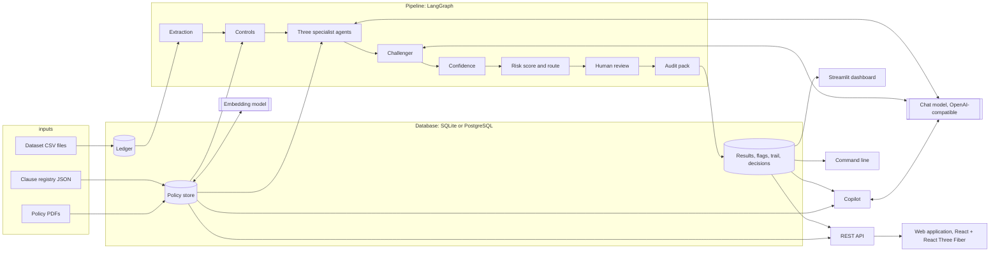

# Architecture

How AuditIQ is put together and why. For the tables and columns see
[DATA_DICTIONARY.md](DATA_DICTIONARY.md), for the datasets
[DATASETS.md](DATASETS.md), for installing and running
[OPERATIONS.md](OPERATIONS.md).

## What the system does

AuditIQ audits vendor invoices that a company has already approved, before
they are paid. For each invoice it gathers the purchase order, the goods
receipt, the vendor record, the approval log and the vendor's other invoices,
checks them against a written policy, and decides whether the invoice can be
paid without review, should be reviewed, or must be reviewed. Every decision
comes with the findings behind it, the evidence each finding quotes, the policy
clause it cites with document and page, and a trail of every step taken.

## Principles

1. **Controls first.** Whatever a comparison of fields can decide is decided by
   code: twelve deterministic controls. A language model is asked only about the
   four clauses that need reading or judgement, after the controls have run.
   The model can add findings; it cannot remove or change a control's finding.
2. **The policy is data.** Every threshold is stored once, in the clause
   registry (`policy/policy_v<version>.json`). The policy text the agents read is
   rendered from the registry, the controls read the registry, and the benchmark
   generator reads it. Changing the policy changes the audit without changing
   code; the policy-swap experiment tests exactly this.
3. **A finding must be checkable.** A finding names a clause and quotes
   evidence as field and value. Code checks that the clause exists and that
   every quoted value is in the records.
4. **Narrow remits.** Each agent sees only the records its clauses need and may
   only raise findings on its own clauses. A finding outside the remit is
   discarded by code.
5. **Nothing is lost.** Results are added, never replaced. A removed finding is
   kept with the reason for its removal. Every result records the
   configuration, policy version, model and prompt hash that produced it.
6. **The answer key stays outside.** No stage reads the labels of a generated
   dataset. The generator and the pipeline share no code, and a test fails if
   one imports the other.

## Components



| Component | Module | Calls a model |
|---|---|---|
| Database, both backends | `auditiq/db.py` | no |
| Data dictionary | `auditiq/datadict.py` | no |
| Loading a ledger from a folder, an Excel workbook or a zip archive, checked first | `auditiq/ledger_import.py` | no |
| Extraction: one transaction per invoice | `auditiq/extraction.py`, `auditiq/db.py` | no |
| Controls | `auditiq/controls.py` | no |
| Agents and challenger | `auditiq/agents.py`, `auditiq/prompts.py` | yes |
| Pipeline graph and configurations | `auditiq/graph.py` | |
| Confidence, score, route | `auditiq/scoring.py` | re-runs only |
| Batch audit, workflow status | `auditiq/service.py` | as configured |
| Audit pack | `auditiq/audit_pack.py` | no |
| Model client and response cache | `auditiq/llm.py` | |
| Policy PDFs and ingestion | `auditiq/policy_pdf.py`, `auditiq/policy_ingest.py` | no |
| Policy search | `auditiq/retrieval.py` | optional |
| Copilot | `auditiq/copilot.py` | yes |
| Command line | `auditiq/cli.py` | |
| REST API and background jobs | `auditiq/api.py` | as configured |
| Web application | `frontend/` (React, TypeScript, React Three Fiber) | through the API |
| Streamlit dashboard | `app/dashboard.py` | optional |
| Benchmark generator | `auditiq_bench/` | no |
| Evaluation | `evaluation/` | as configured |

## The pipeline

The pipeline is a LangGraph `StateGraph`. One invocation audits one invoice.

| Stage | What it does |
|---|---|
| Extraction | Builds the transaction: the invoice, its PO and GRN (when they exist), the vendor, the approval log oldest first, and the vendor's other invoices. Only the audited columns are read (see the data dictionary). |
| Controls | Twelve checks, one or more per rule-defined clause: amount match, quantity match, missing reference, exact duplicate, GSTIN format, state code, GSTIN against the vendor master, same-day splitting, non-business day, round amount, blocked vendor, approval limit. Each returns a finding with evidence or nothing. |
| Specialist agents | Three agents run in parallel, one structured model call each. They receive the policy, the control findings and their own records, and return findings as JSON. |
| Challenger | One model call that sees the agents' findings and the records those agents saw, and returns keep or remove for each, with a reason. It is not called when no agent raised a finding. It cannot touch a control finding, and a finding it does not rule on is kept. |
| Confidence | For each agent finding: grounding, clause validity and agreement (below). |
| Risk score and route | Two scores and the route (below). |
| Human review | With review enabled, an escalated invoice pauses the graph (`interrupt`) until a reviewer decides. In batch runs the result is queued instead. |
| Audit pack | Assembles the result from the verified findings; no model writes it. |

### Configurations

The five configurations of the paper are the same nodes with some left out:

| | Controls | Agents | Challenger | Confidence | Model calls per invoice |
|---|---|---|---|---|---|
| C1 | yes | none | | | 0 |
| C2 | no | one prompt over the whole policy | | | 1 |
| C3 | yes | three specialists | | | 3 |
| C4 | yes | three specialists | yes | | 3, plus 1 when an agent raised a finding |
| C5 | yes | three specialists | yes | yes | as C4, plus 3 re-runs of each agent that raised a kept finding |

C0, the classical baseline (isolation forest and one-class SVM on engineered
features), lives in `evaluation/run_c0.py` and is not part of the pipeline.

### Agents

| Agent | Policy sections | Judgement clauses | Records it sees |
|---|---|---|---|
| Math and Approvals | 2.1, 5 | 2.1.4 receipt remarks, 2.1.5 description match | invoice, PO, GRN, approval log |
| Tax and Identity | 2.2, 3 | 2.2.2 near duplicate | invoice, vendor, vendor history (number, date, amount, PO, GRN) |
| Vendor Intelligence | 4 | 4.1.2 structuring across days | invoice, vendor, approval log, vendor history (date, amount, description, approver) |

All stages share one system message, which holds the policy, so that the
policy is a common prompt prefix that a server can cache. Prompt templates
contain no number: rule numbers and thresholds reach the model only through the
policy text (a test enforces this).

A reply must be one JSON object. A reply that is not is sent back once with a
request to repair it; if the second reply is unusable the stage fails, counts
as a failed stage and contributes nothing, and the other stages continue.

**Vendor history is bounded.** A vendor can have well over a hundred invoices.
An agent is shown all of them up to 40; above that, the 40 that a fixed rule
ranks first, and the prompt says how many of how many are shown. The Tax and
Identity agent's rule ranks invoices that bill the same PO or GRN first, then
those of the same amount, then by similarity of the invoice number, then by
closeness in time. The Vendor Intelligence agent's rule ranks by closeness in
time. The single-prompt auditor of C2 and the challenger get the union. The
rule reads only the records, so a re-run asks the same question.
`python -m evaluation.history_cap` checks on every dataset that no labelled
case loses an invoice it depends on (`results/history_cap.md`).

### Confidence

For a finding f raised by an agent:

- **g, grounding** is 1 when every piece of evidence the finding quotes is found
  in the transaction at the named field with the quoted value, else 0.
- **p, clause validity** is 1 when the cited clause exists in the active policy.
- **a, agreement** is the share of m = 3 re-runs of the same agent at
  temperature 0.7 that cite the same clause again.

Confidence is c = (g + p + a) / 3. A control finding has confidence 1.

Confidence measures whether a finding is supported and stable. It does not
measure whether it is correct: a model that makes the same mistake every time
gets full agreement.

### Score and route

Severity weights are critical 30, high 20, medium 10, low 5. A kept critical
finding lifts the score to at least 70, a high one to at least 50.

- **R0, count-based:** the sum of the weights, capped at 100, with the floors.
- **Rc, confidence-weighted:** each weight is multiplied by the finding's
  confidence, and only findings with confidence of at least 2/3 trigger a floor.

With threshold 50: `escalate` when Rc is at least 50; `sample` when R0 is at
least 50 and Rc is not; `approve` otherwise. Rc never exceeds R0, so
confidence weighting never changes which invoices are approved; it only moves
invoices from mandatory review to sampled review. A test checks this property
on generated flags.

The workflow status follows from the route: `approve` gives `AUTO_APPROVED`,
`escalate` gives `PENDING_REVIEW`, and `sample` gives `PENDING_REVIEW` for the
share drawn for review (by a hash of the invoice id, so the draw is
reproducible) and `NOT_SAMPLED` for the rest. A reviewer's decision sets
`REVIEW_APPROVED`, `REVIEW_REJECTED` or `REVIEW_OVERRIDDEN`; an override needs
a written justification.

## The model client

`auditiq/llm.py` is a small client for any server that offers
`POST {base_url}/chat/completions` in the OpenAI format: a local Ollama, vLLM,
or a hosted provider. Nothing else in the system knows which.

- **Cache.** Every reply is stored in `.auditiq/llm_cache.sqlite` under a key
  made of the whole request and the sample number. A repeated run makes no new
  calls, and C3, C4 and C5 share their agent calls.
- **Context guard.** With `AUDITIQ_LLM_CONTEXT` set, a prompt that would not
  fit the server's context window is refused. Without it, a local server may
  cut a long prompt without saying so.
- **Retries.** Transport errors, HTTP 408, 409, 429 and 5xx are retried with
  exponential backoff, honouring `Retry-After`; other client errors fail at once.
- **Determinism.** Decisions are requested at temperature 0 with a seed where
  the server accepts one. Agreement re-runs use temperature 0.7 and distinct
  seeds.

## Storage

One interface (`Database` in `auditiq/db.py`) over two backends:

| | SQLite | PostgreSQL |
|---|---|---|
| When | default; one file, no server | `AUDITIQ_DATABASE_URL` is a `postgresql://` URL |
| Money | `REAL` | `NUMERIC(15,2)` |
| Dates | ISO text | `DATE`, `TIMESTAMP` |
| Read-only access for the copilot | read-only connection and an authorizer | read-only transaction and the role `auditiq_reader`, which may select from the copilot's tables only |

SQL is written once with `?` placeholders. Loaders convert `NUMERIC` to float
and dates to ISO strings on PostgreSQL, so every stage sees the same values on
both backends; the test suite runs the database, policy, command-line,
dashboard and API tests against both.

A new database gets the schema on its first connection, which records a stamp
of the schema version in `meta`. Later connections read the stamp and change
nothing, so a connection takes no exclusive lock; on PostgreSQL, creating the
schema holds an advisory lock, so that two connections never create it at
once. (Re-creating the views on every connection let two web requests that
connected together deadlock.)

A batch run is one row in `audit_runs`. Each audited invoice adds one row to
`audit_results`, its findings to `audit_flags` and its steps to `audit_trail`,
committed every 200 invoices. The view `v_latest_results` gives the current
result of every invoice, and `v_review_queue` the results waiting for review.

## Policy documents and retrieval

```
policy_v2.5.json --build_policy.py--> SOP_v2.5.md --policy_pdf.py--> Procurement_Audit_SOP_v2.5.pdf
                                                                          |
                 clause registry <----- verified against ----- policy_ingest.py --> policy_chunks
```

Ingestion reads a PDF with PyMuPDF, uses font size and indentation to find
headings and numbered rules, and stores one passage per rule and per other
paragraph, each with its page. The text of every rule is compared with the
registry of the same version; a rule that differs is marked unverified and
reported, because the document and the applied policy would then disagree.

Policy search has three rankings:

| Ranking | Needs | Finds |
|---|---|---|
| lexical | nothing | passages that share wording with the question (TF-IDF over words and character n-grams) |
| dense | an embedding model | passages that mean the same in other words |
| hybrid | an embedding model | both, merged by reciprocal rank fusion |

Optionally the chat model first restates the question in the policy's terms.
The default ranking was chosen on the development half of the paraphrased
questions and is reported on the other half (`results/retrieval.md`).

## Copilot

Three kinds of question, each answered from retrieved material with citations:

1. **Policy questions** are answered from the retrieved passages, citing rule,
   document and page.
2. **Invoice questions** ("why was INV... flagged?") are answered from the
   stored audit pack of that invoice and the passages of the clauses it cites.
   Those passages are put first whatever the wording of the question, and the
   model is told that the audit record is the authority on what was found: a
   question that names no rule otherwise retrieves the wrong rules, and a small
   model then follows them (observed on a real model and fixed on 2026-10-14).
3. **Data questions** are answered by one SQL `SELECT` that the model writes.
   The query is checked and confined in layers: it must be a single `SELECT`;
   it may not name any object outside the allowed tables and views
   (`benchmark_labels` and system catalogues are refused); it runs on a
   read-only connection, with a row limit and a time limit; on SQLite an
   authorizer refuses every other object, on PostgreSQL the query runs as the
   role `auditiq_reader`.

## REST API and web application

`auditiq/api.py` is a FastAPI application over the same modules the command
line uses; it holds no state of its own between requests, and every request
opens its own database connection, so it serves SQLite and PostgreSQL alike.
Work that takes long (an audit with a model, re-auditing a ledger after a
policy change, a copilot answer, reading a policy with a model) runs as a
background job on a thread with its own connection: the request answers 202
with a job id, and `GET /api/jobs/{id}` reports progress and the result. An
optional bearer token protects every endpoint except the health check.

`frontend/` is a single-page application in React and TypeScript that uses the
API only. It shows the overview with a 3D map of every vendor's risk (React
Three Fiber, one instanced mesh), the review queue and the decision form,
single invoices with their audit pack and trail, policy adoption from a PDF
(with the model's proposal and the reviewer's confirmation when the document is
in its own wording), the copilot, the pipeline as a 3D graph that lights the
stages of each configuration, and the measured results read from `results/`.
Every 3D view has a table with the same data next to it and a fallback when
the browser has no WebGL. [WEB.md](WEB.md) describes the endpoints, the
security measures, the pages and the tests.

## Streamlit dashboard

A Streamlit application (`app/dashboard.py`), the lightweight alternative to
the web application, with five pages: **Overview** (counts by status, findings
by rule), **Review queue** (the waiting results and the decision form),
**Invoice** (the audit pack and the trail of one invoice, with a button to
audit it again), **Policy** (the clauses and parameters of each version,
adoption of a policy document, and policy search), **Copilot**.

## Evaluation

| Script | Does |
|---|---|
| `python -m auditiq_bench` | generates the datasets and validates them |
| `python -m evaluation.run_all` | C0 and C1 on every dataset, the policy swap, construction checks; writes `results/summary.md` |
| `python -m evaluation.run_config` | one configuration over a dataset; one prediction per invoice, resumable |
| `python -m evaluation.run_pilot` | every configuration on one small sample, side by side |
| `python -m evaluation.report` | metrics with bootstrap intervals; McNemar's exact test with Holm correction |
| `python -m evaluation.retrieval_eval` | policy retrieval on 48 fixed questions |
| `python -m evaluation.history_cap` | checks the vendor-history cap against the labels |
| `python -m evaluation.policy_change` | 14 policy documents read and applied to five ledgers, against frozen thresholds |
| `python -m evaluation.scalability` | throughput of the control stage against worker processes and ledger size |
| `python -m evaluation.policy_llm_eval` | a model reading policies in their own wording, and what the code check catches |

Metrics are ratios of weighted sums, so that the evaluation subset of a ledger
estimates the whole ledger (see DATASETS.md). The classical detectors choose
their thresholds by five-fold cross-fitting: the threshold applied to a fold is
chosen on the other four, so no invoice is scored with a threshold tuned on its
own label.

## Limits of the design

- The agents judge one invoice at a time with a bounded view of the vendor. A
  pattern spread over more than 40 of a vendor's invoices is outside what an
  agent can see.
- Confidence rewards stability, not correctness (see above).
- The controls are exactly as good as the registry: a clause that is missing
  from the registry is not checked.
- The system audits; it does not block payments, post to an ERP or notify
  anyone. The review queue is where its output meets a person.
- The API runs as one process; its background jobs live in that process's
  memory, and it has one shared token, not user accounts.
