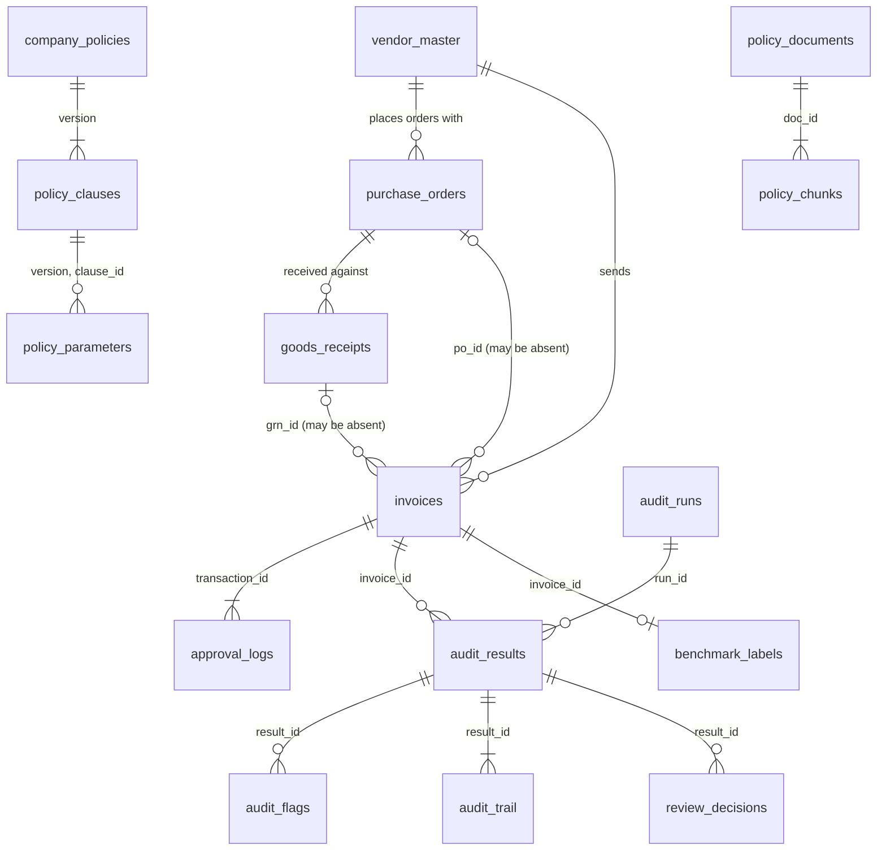

# Data dictionary

Every table and column of the AuditIQ database: its type on both backends, what it means and which part of the system uses it. **This file is generated** from `auditiq/datadict.py` and the schema in `auditiq/db.py` by `python -m auditiq.datadict`; edit those, not this file.

The five ledger tables have the same columns as the five CSV files of a dataset, and `benchmark_labels` those of `labels.csv` ([DATASETS.md](DATASETS.md) describes the datasets). `python -m auditiq export --out <folder>` writes every table as CSV.

## Conventions

- **Backends.** The schema is the same on SQLite and PostgreSQL, with the column types of each. Money is `NUMERIC(15,2)` on PostgreSQL and `REAL` on SQLite; dates and timestamps are `DATE` and `TIMESTAMP` on PostgreSQL and ISO text (`YYYY-MM-DD`, `YYYY-MM-DD HH:MM:SS`) on SQLite. The application reads floats and ISO strings from both, so every stage decides identically on both.
- **Flags** are integers, 1 for true and 0 for false, on both backends.
- **Money** is in Indian rupees, before tax unless the column says otherwise.
- **Identifiers** of ledger records are text with a prefix (`VEND`, `PO`, `GRN`, `INV`, `LOG`). Identifiers of rows the application creates are integers assigned by the database.
- **Audited** marks the ledger columns that the controls and agents can read. The other ledger columns are carried for the reviewer, the dashboard and the copilot; no control or agent sees them, so nothing in them can influence a decision.
- **Everything is synthetic.** No vendor, person, GSTIN or invoice in a generated dataset is real.

## Relations

`invoices.po_id` and `invoices.grn_id` are not declared as foreign keys: an invoice may name an order that is not on record, and finding that is the job of Rule 2.1.3.

## Ledger

The records under audit. They are loaded from the five CSV files of a dataset by `python -m auditiq setup --dataset <folder>`, or from a workbook or zip archive of the same tables (`ledger import`, the web application), and are never changed by the audit.

### `vendor_master`

One row per vendor.

- **Written by:** `vendor_master.csv`
- **Used by:** Extraction attaches the vendor to each of its invoices. Controls 3.1.3 and 4.4.1 read it, as do the Tax and Identity agent and the Vendor Intelligence agent.

| Column | SQLite | PostgreSQL | Audited | Meaning |
|---|---|---|---|---|
| `vendor_id` | TEXT PRIMARY KEY | TEXT PRIMARY KEY | yes | Vendor identifier: `VEND` and four digits. |
| `vendor_name` | TEXT NOT NULL | TEXT NOT NULL | yes | Registered name of the vendor. |
| `official_gstin` | TEXT | TEXT | yes | The GSTIN registered for the vendor: 15 characters, of which the first two are the state code. Control 3.1.3 compares the GSTIN printed on an invoice with it. |
| `pan_number` | TEXT | TEXT | | The vendor's PAN: characters 3 to 12 of the GSTIN. |
| `vendor_category` | TEXT | TEXT | yes | One of Raw Materials, MRO, Logistics, IT Services, Utilities, Professional Services. The category decides what the vendor sells and which department orders from it. |
| `city` | TEXT | TEXT | | City of the registered address. |
| `state` | TEXT | TEXT | | State of the registered address; it agrees with the state code of the GSTIN. |
| `country` | TEXT | TEXT | | `India` for every vendor. |
| `gstin_status` | TEXT | TEXT | yes | Status of the registration with the tax authority: `Active` or `Suspended`. A status listed in parameter `blocked_gstin_statuses` of Rule 4.4.1 blocks the vendor. |
| `kyc_status` | TEXT | TEXT | | `Verified` for every generated vendor. |
| `is_active` | INTEGER | SMALLINT | | 1 for every generated vendor. |
| `blacklisted` | INTEGER NOT NULL DEFAULT 0 | SMALLINT NOT NULL DEFAULT 0 | yes | 1 when the vendor is on the company's blacklist (Rule 4.4.1), otherwise 0. |
| `blacklist_status` | INTEGER | SMALLINT | | Copy of `blacklisted` under the column name of the prototype's schema. |

### `purchase_orders`

One row per purchase order: what the company ordered from a vendor.

- **Written by:** `purchase_orders.csv`
- **Used by:** Extraction attaches the order an invoice refers to. Control 2.1.1 compares amounts, Rule 2.1.5 (Math and Approvals agent) compares descriptions.

| Column | SQLite | PostgreSQL | Audited | Meaning |
|---|---|---|---|---|
| `po_id` | TEXT PRIMARY KEY | TEXT PRIMARY KEY | yes | Order identifier: `PO` and five digits. |
| `vendor_id` | TEXT REFERENCES vendor_master(vendor_id) | TEXT REFERENCES vendor_master(vendor_id) | yes | The vendor the order was placed with. |
| `po_date` | TEXT | DATE | yes | Date the order was issued. It precedes the receipt and the invoice. |
| `amount` | REAL | NUMERIC(15,2) | yes | Value of the order before tax: `quantity` times `unit_price`. Control 2.1.1 compares the invoice amount with it. |
| `po_amount` | REAL | NUMERIC(15,2) | | Copy of `amount` under the column name of the prototype's schema. |
| `quantity` | INTEGER | INTEGER | yes | Units ordered. |
| `unit_price` | REAL | NUMERIC(15,2) | yes | Agreed price per unit, before tax. |
| `tax_amount` | REAL | NUMERIC(15,2) | | GST at 18% of `amount`. |
| `total_amount` | REAL | NUMERIC(15,2) | | `amount` plus `tax_amount`. |
| `currency` | TEXT | TEXT | | `INR` for every order. |
| `department` | TEXT | TEXT | | Department that raised the order; it follows from the vendor's category. |
| `requester` | TEXT | TEXT | | Employee who raised the order. |
| `status` | TEXT | TEXT | | `Closed` for every generated order. |
| `description` | TEXT | TEXT | yes | What was ordered, in words. Rule 2.1.5 asks whether the invoice bills the same thing. |

### `goods_receipts`

One row per goods receipt note (GRN): what the stores received against an order.

- **Written by:** `goods_receipts.csv`
- **Used by:** Extraction attaches the receipt an invoice refers to. Control 2.1.2 compares quantities, Rule 2.1.4 (Math and Approvals agent) reads the receiver's remark.

| Column | SQLite | PostgreSQL | Audited | Meaning |
|---|---|---|---|---|
| `grn_id` | TEXT PRIMARY KEY | TEXT PRIMARY KEY | yes | Receipt identifier: `GRN` and five digits. |
| `po_id` | TEXT REFERENCES purchase_orders(po_id) | TEXT REFERENCES purchase_orders(po_id) | yes | The order the goods were received against. |
| `vendor_id` | TEXT REFERENCES vendor_master(vendor_id) | TEXT REFERENCES vendor_master(vendor_id) | | The vendor that delivered. |
| `receipt_date` | TEXT | DATE | yes | Date of the receipt, between the order date and the invoice date. |
| `received_quantity` | INTEGER | INTEGER | yes | Units accepted into stores. Control 2.1.2 compares the billed quantity with it. |
| `ordered_quantity` | INTEGER | INTEGER | yes | Units on the order. |
| `unit_price` | REAL | NUMERIC(15,2) | | Price per unit, as on the order. |
| `amount` | REAL | NUMERIC(15,2) | yes | `received_quantity` times `unit_price`. |
| `received_amount` | REAL | NUMERIC(15,2) | | Copy of `amount` under the column name of the prototype's schema. |
| `received_by` | TEXT | TEXT | | Storekeeper who signed the receipt. |
| `warehouse_location` | TEXT | TEXT | | `Main Stores` for every generated receipt. |
| `quality_check` | TEXT | TEXT | | `Passed` for every generated receipt. What happened at a particular inspection is written in `notes`. |
| `status` | TEXT | TEXT | | `Complete` for every generated receipt. |
| `notes` | TEXT | TEXT | yes | Free-text remark of the receiver, for example "QC passed; full quantity accepted." or a remark that some units were rejected. Rule 2.1.4 is violated when the remark contradicts the quantity billed; only an agent can read that. |

### `invoices`

One row per vendor invoice: the unit of audit.

- **Written by:** `invoices.csv`
- **Used by:** Every control and agent reads the invoice under audit. The other invoices of the same vendor are its vendor history, which the duplicate, splitting and structuring rules need.

| Column | SQLite | PostgreSQL | Audited | Meaning |
|---|---|---|---|---|
| `invoice_id` | TEXT PRIMARY KEY | TEXT PRIMARY KEY | yes | The company's identifier of the invoice: `INV` and five digits, in order of invoice date. |
| `vendor_id` | TEXT REFERENCES vendor_master(vendor_id) | TEXT REFERENCES vendor_master(vendor_id) | yes | The vendor that sent the invoice. |
| `invoice_number` | TEXT | TEXT | yes | The vendor's own number printed on the invoice. Its format differs from vendor to vendor. Rule 2.2.1 (exact duplicate) and Rule 2.2.2 (near duplicate) compare it with the vendor's other invoices. |
| `date` | TEXT | DATE | yes | Invoice date. Rules 4.1.1, 4.1.2 and 4.2.1 depend on it. |
| `invoice_date` | TEXT | TIMESTAMP | | The same date as a timestamp at midnight, under the column name of the prototype's schema. |
| `due_date` | TEXT | DATE | | `date` plus 30 days. |
| `amount` | REAL | NUMERIC(15,2) | yes | Billed value before tax. Rules 2.1.1, 4.1.2, 4.3.1 and 5.1.1 depend on it. |
| `invoice_amount` | REAL | NUMERIC(15,2) | | Copy of `amount` under the column name of the prototype's schema. |
| `quantity` | INTEGER | INTEGER | yes | Units billed. Control 2.1.2 compares it with the received quantity. |
| `unit_price` | REAL | NUMERIC(15,2) | yes | Price per unit billed. |
| `currency` | TEXT | TEXT | | `INR` for every invoice. |
| `tax_amount` | REAL | NUMERIC(15,2) | | GST at 18% of `amount`. |
| `total_amount` | REAL | NUMERIC(15,2) | | `amount` plus `tax_amount`. |
| `gstin` | TEXT | TEXT | yes | The GSTIN printed on the invoice. Rules 3.1.1 to 3.1.3 check its form, its state code and whether it is the vendor's registered one. |
| `po_id` | TEXT | TEXT | yes | The order the invoice refers to. NULL when the invoice names none. It can name an order that is not on record, which is why it is not a foreign key (Rule 2.1.3). |
| `grn_id` | TEXT | TEXT | yes | The receipt the invoice refers to. NULL when the invoice names none (Rule 2.1.3). |
| `department` | TEXT | TEXT | | Department the invoice is charged to. |
| `payment_terms` | TEXT | TEXT | | `Net 30` for every invoice. |
| `payment_status` | TEXT | TEXT | | `Unpaid` for every invoice: the audit runs before payment. |
| `approval_status` | TEXT | TEXT | | State in the company's own approval workflow, `Approved` for every invoice: the audit examines invoices that were approved. It is not the outcome of the audit; that is `audit_results.workflow_status`. |
| `approved_by` | TEXT | TEXT | | Name of the final approver, the last entry of the invoice in `approval_logs`. |
| `description` | TEXT | TEXT | yes | What is billed, in words. Rule 2.1.5 compares it with the order's description. |

Also: `INDEX (vendor_id, date)`.

### `approval_logs`

One row per step of the approval of an invoice. Most invoices have one entry, the approval. Some have an `Escalated` entry before it: a lower role passing the invoice on to the role that approved it.

- **Written by:** `approval_logs.csv`
- **Used by:** Extraction attaches the entries of an invoice, oldest first. Control 5.1.1 checks the final approver's limit; Rule 4.1.2 (Vendor Intelligence agent) reads who approved neighbouring invoices.

| Column | SQLite | PostgreSQL | Audited | Meaning |
|---|---|---|---|---|
| `log_id` | TEXT PRIMARY KEY | TEXT PRIMARY KEY | yes | Entry identifier: `LOG` and five digits, in order of time. |
| `transaction_id` | TEXT | TEXT | yes | The invoice the entry belongs to (`invoices.invoice_id`). |
| `approver_name` | TEXT | TEXT | yes | Name of the approver. |
| `approver_role` | TEXT | TEXT | yes | `Manager`, `Senior Manager`, `Director` or `CFO`. |
| `timestamp` | TEXT | TIMESTAMP | yes | When the approver acted. |
| `action_taken` | TEXT | TEXT | yes | `Escalated` (passed on to a higher role) or `Approved` (final). Every invoice has exactly one `Approved` entry, and it is the last. |
| `amount_limit` | REAL | NUMERIC(15,2) | yes | The approval limit of the role as the approval system recorded it. Control 5.1.1 does not use this column: it takes the limit of the role from the active policy, so that a change of policy changes the decision. |

Also: `INDEX (transaction_id)`.

## Policy

The policy the audit applies: the clause registry and the rendered text of every version, and the policy documents (PDF) cut into passages for retrieval.

### `company_policies`

One row per version of the policy.

- **Written by:** `setup` (from `policy/policy_v<version>.json` and the text rendered from it), and `python -m auditiq policy adopt <file.pdf>`, which reads a version from a policy document
- **Used by:** The pipeline reads the active version when a run starts: the controls take their thresholds from `registry`, the agents read `markdown_content`.

| Column | SQLite | PostgreSQL | Meaning |
|---|---|---|---|
| `version` | TEXT PRIMARY KEY | TEXT PRIMARY KEY | Version of the policy, for example `2.5`. |
| `policy_name` | TEXT | TEXT | Title of the policy. |
| `effective_date` | TEXT | DATE | First day the version is in force. |
| `markdown_content` | TEXT NOT NULL | TEXT NOT NULL | The policy as text. This is what the agents read; it is rendered from the registry, so a threshold appears in the text exactly as the controls apply it. |
| `registry` | TEXT NOT NULL | TEXT NOT NULL | The clause registry as JSON: every clause with its title, severity, kind and parameters. The only place where thresholds are stored. A version that a model helped to read from a document also records, under `adoption`, the model, the reviewer who confirmed the values, the time, and which values the reviewer supplied. |
| `is_active` | INTEGER NOT NULL DEFAULT 0 | SMALLINT NOT NULL DEFAULT 0 | 1 for the version the audit applies, 0 for the others. Exactly one row has 1. |

### `policy_clauses`

One row per clause of each policy version; the registry of `company_policies` in relational form.

- **Written by:** With the policy version: `setup` or `policy adopt`
- **Used by:** The dashboard and the copilot. The pipeline reads the registry itself.

| Column | SQLite | PostgreSQL | Meaning |
|---|---|---|---|
| `version` | TEXT NOT NULL REFERENCES company_policies(version) ON DELETE CASCADE | TEXT NOT NULL REFERENCES company_policies(version) ON DELETE CASCADE | Policy version. |
| `clause_id` | TEXT NOT NULL | TEXT NOT NULL | Number of the clause, for example `2.1.1`. Findings cite it as "Rule 2.1.1". |
| `title` | TEXT NOT NULL | TEXT NOT NULL | Short title of the clause. |
| `severity` | TEXT NOT NULL | TEXT NOT NULL | `low`, `medium`, `high` or `critical`. Every clause has one severity; a finding takes the severity of the clause it cites. |
| `kind` | TEXT NOT NULL | TEXT NOT NULL | `control` when a comparison of fields decides the clause, so that code checks it; `judgement` when deciding it needs reading, so that an agent checks it. |

Also: `PRIMARY KEY (version, clause_id)`.

### `policy_parameters`

One row per parameter of a clause: the thresholds of the policy.

- **Written by:** With the policy version: `setup` or `policy adopt`
- **Used by:** The dashboard shows them and compares versions. The controls read the same values from the registry.

| Column | SQLite | PostgreSQL | Meaning |
|---|---|---|---|
| `version` | TEXT NOT NULL | TEXT NOT NULL | Policy version. |
| `clause_id` | TEXT NOT NULL | TEXT NOT NULL | The clause the parameter belongs to. |
| `param_name` | TEXT NOT NULL | TEXT NOT NULL | Name of the parameter, for example `amount_tolerance_pct` or `approval_limits`. |
| `param_value` | TEXT NOT NULL | TEXT NOT NULL | The value, JSON-encoded: a number, a list, or an object such as the limit of each role. |

Also: `PRIMARY KEY (version, clause_id, param_name)`; `FOREIGN KEY (version, clause_id) REFERENCES policy_clauses(version, clause_id) ON DELETE CASCADE`.

### `policy_documents`

One row per ingested policy document (PDF).

- **Written by:** `python -m auditiq policy ingest <file.pdf>` and `policy adopt <file.pdf>`; `setup` ingests the PDFs in `policy/pdf`
- **Used by:** Citations name the document and the page of a passage.

| Column | SQLite | PostgreSQL | Meaning |
|---|---|---|---|
| `doc_id` | INTEGER autoincrement, PRIMARY KEY | BIGINT identity, PRIMARY KEY | Identifier of the document. |
| `file_name` | TEXT NOT NULL UNIQUE | TEXT NOT NULL UNIQUE | File name of the PDF. Ingesting a file of the same name again replaces the document. |
| `title` | TEXT | TEXT | Title found on the first page. |
| `version` | TEXT | TEXT | Policy version the document states, when it states one. |
| `pages` | INTEGER | INTEGER | Number of pages. |
| `sha256` | TEXT | TEXT | SHA-256 of the file, so that the exact document a citation refers to can be identified. |
| `ingested_at` | TEXT | TIMESTAMP | When the document was ingested. |

### `policy_chunks`

One row per passage of a policy document: a clause, or a paragraph that is not a clause.

- **Written by:** Policy ingestion and adoption; `python -m auditiq policy embed` fills the embedding columns
- **Used by:** Policy search and the copilot retrieve passages; an audit pack cites the page of each clause it uses.

| Column | SQLite | PostgreSQL | Meaning |
|---|---|---|---|
| `chunk_id` | INTEGER autoincrement, PRIMARY KEY | BIGINT identity, PRIMARY KEY | Identifier of the passage. |
| `doc_id` | BIGINT NOT NULL REFERENCES policy_documents(doc_id) ON DELETE CASCADE | BIGINT NOT NULL REFERENCES policy_documents(doc_id) ON DELETE CASCADE | The document the passage comes from. |
| `version` | TEXT | TEXT | Policy version of the document. |
| `position` | INTEGER NOT NULL | INTEGER NOT NULL | Position of the passage in the document, from 0. |
| `kind` | TEXT NOT NULL | TEXT NOT NULL | `clause` for a numbered rule, `text` for any other paragraph. |
| `clause_id` | TEXT | TEXT | Number of the clause, for a passage of kind `clause`. |
| `section` | TEXT | TEXT | Heading of the section the passage stands under. |
| `page` | INTEGER | INTEGER | Page of the PDF on which the passage begins, from 1. |
| `text` | TEXT NOT NULL | TEXT NOT NULL | Text of the passage as extracted from the PDF. |
| `verified` | INTEGER | SMALLINT | For a clause: 1 when the text extracted from the PDF equals the text of that clause in the registry of the same version, 0 when it differs. NULL for other passages, and for the passages a model located in a policy written in its own wording. A clause that is not verified is reported at ingestion, because the PDF and the applied policy then disagree. |
| `embedding` | BLOB | BYTEA | Embedding of the passage: a vector of 32-bit floats of unit length, stored as bytes. NULL until `policy embed` has run. |
| `embed_model` | TEXT | TEXT | Identifier of the model that produced the embedding. |

## Audit

What the audit produced. Every audit of an invoice adds rows, so an invoice that is audited again has one result per run and the earlier ones remain. The only later change to a result is its review: the decision sets the status of the result, is added to its audit pack and closes its audit trail.

### `audit_runs`

One row per run: one configuration applied to a set of invoices under one policy version.

- **Written by:** `python -m auditiq run`, `audit`, and the dashboard
- **Used by:** Everything that reports a result names its run, so that the configuration, the policy version, the model and the prompts behind a decision are known.

| Column | SQLite | PostgreSQL | Meaning |
|---|---|---|---|
| `run_id` | INTEGER autoincrement, PRIMARY KEY | BIGINT identity, PRIMARY KEY | Identifier of the run. |
| `configuration` | TEXT NOT NULL | TEXT NOT NULL | `C1` to `C5`: which stages of the pipeline ran. |
| `policy_version` | TEXT NOT NULL | TEXT NOT NULL | The policy version that was applied. |
| `model` | TEXT | TEXT | Identifier of the chat model. NULL for C1, which calls no model. |
| `prompt_hash` | TEXT | TEXT | Hash of the prompt templates. NULL for C1. |
| `note` | TEXT | TEXT | Free text given when the run was started. |
| `started_at` | TEXT | TIMESTAMP | When the run started. |
| `finished_at` | TEXT | TIMESTAMP | When the run finished. NULL while it is running or if it was interrupted. |

### `audit_results`

One row per invoice per run: the decision of the audit.

- **Written by:** The pipeline, at the end of each invoice
- **Used by:** The review queue, the dashboard, the copilot.

| Column | SQLite | PostgreSQL | Meaning |
|---|---|---|---|
| `result_id` | INTEGER autoincrement, PRIMARY KEY | BIGINT identity, PRIMARY KEY | Identifier of the result. |
| `run_id` | BIGINT NOT NULL REFERENCES audit_runs(run_id) ON DELETE CASCADE | BIGINT NOT NULL REFERENCES audit_runs(run_id) ON DELETE CASCADE | The run that produced it. |
| `invoice_id` | TEXT NOT NULL REFERENCES invoices(invoice_id) | TEXT NOT NULL REFERENCES invoices(invoice_id) | The invoice that was audited. |
| `vendor_id` | TEXT | TEXT | Its vendor, repeated here so that results can be grouped without a join. |
| `route` | TEXT NOT NULL | TEXT NOT NULL | `approve` (no review), `sample` (the count-based score reaches the threshold but the confidence-weighted score does not: a share of these is reviewed) or `escalate` (review). |
| `risk_level` | TEXT | TEXT | `LOW`, `MEDIUM` (score 30 or more), `HIGH` (50 or more) or `CRITICAL` (70 or more), from `rc`. |
| `r0` | REAL | DOUBLE PRECISION | Count-based risk score, 0 to 100: every finding counts fully. |
| `rc` | REAL | DOUBLE PRECISION | Confidence-weighted risk score, 0 to 100: every finding counts in proportion to its confidence. Never above `r0`. Equal to `r0` in a configuration without confidence scoring. |
| `flag_count` | INTEGER | INTEGER | Number of findings that were kept. |
| `workflow_status` | TEXT NOT NULL | TEXT NOT NULL | `AUTO_APPROVED`, `PENDING_REVIEW`, `NOT_SAMPLED` (route `sample`, not drawn for review), or after review `REVIEW_APPROVED`, `REVIEW_REJECTED`, `REVIEW_OVERRIDDEN`. |
| `llm_calls` | INTEGER | INTEGER | Number of model calls made for this invoice, including calls served from the cache. |
| `prompt_tokens` | INTEGER | INTEGER | Tokens sent to the model. |
| `completion_tokens` | INTEGER | INTEGER | Tokens the model returned. |
| `latency_ms` | REAL | DOUBLE PRECISION | Time the model took, in milliseconds. |
| `failed_stages` | INTEGER | INTEGER | Stages whose reply could not be used even after one request to repair it. A failed stage contributes no finding; the others continue. |
| `audit_pack` | TEXT NOT NULL | TEXT NOT NULL | The complete result as JSON: the records examined, every finding with its evidence and its confidence, the findings the challenger removed and why, the scores, the route, the policy citations and, after review, the decision. |
| `created_at` | TEXT | TIMESTAMP | When the result was stored. |

Also: `UNIQUE (run_id, invoice_id)`; `INDEX (invoice_id)`; `INDEX (workflow_status)`.

### `audit_flags`

One row per finding of a result, including findings the challenger removed.

- **Written by:** The pipeline, with the result
- **Used by:** The dashboard and the copilot; the same findings are inside `audit_results.audit_pack`.

| Column | SQLite | PostgreSQL | Meaning |
|---|---|---|---|
| `flag_id` | INTEGER autoincrement, PRIMARY KEY | BIGINT identity, PRIMARY KEY | Identifier of the finding. |
| `result_id` | BIGINT NOT NULL REFERENCES audit_results(result_id) ON DELETE CASCADE | BIGINT NOT NULL REFERENCES audit_results(result_id) ON DELETE CASCADE | The result the finding belongs to. |
| `clause` | TEXT | TEXT | The clause the finding cites, for example `2.1.1`. |
| `severity` | TEXT | TEXT | Severity of that clause. |
| `source` | TEXT | TEXT | `D` for a deterministic control, `L` for an agent (LLM). |
| `agent` | TEXT | TEXT | Name of the control or of the agent that raised the finding. |
| `status` | TEXT NOT NULL | TEXT NOT NULL | `kept`, or `removed` when the challenger rejected the finding. |
| `g` | INTEGER | INTEGER | Grounding, 1 or 0: every piece of evidence the finding quotes is found in the records with that value. NULL for a control or when confidence was not computed. |
| `p` | INTEGER | INTEGER | Clause validity, 1 or 0: the cited clause exists in the active policy. NULL as for `g`. |
| `a` | REAL | DOUBLE PRECISION | Agreement, 0 to 1: the share of the agent's re-runs that cite the same clause again. NULL as for `g`. |
| `confidence` | REAL | DOUBLE PRECISION | Mean of `g`, `p` and `a`. 1 for a control and in a configuration without confidence scoring. |
| `message` | TEXT | TEXT | The finding in words. |
| `evidence` | TEXT | TEXT | JSON list of the quoted evidence: `{"field": "grn.notes", "value": "..."}`. |
| `removal_reason` | TEXT | TEXT | The challenger's reason, for a removed finding. |

Also: `INDEX (result_id)`.

### `audit_trail`

One row per step taken for a result, in order: what ran, who or what did it, and what it cost.

- **Written by:** The pipeline, with the result; the review adds its own entry
- **Used by:** `python -m auditiq show`, the dashboard. It answers "how was this decision reached".

| Column | SQLite | PostgreSQL | Meaning |
|---|---|---|---|
| `entry_id` | INTEGER autoincrement, PRIMARY KEY | BIGINT identity, PRIMARY KEY | Identifier of the entry. |
| `result_id` | BIGINT NOT NULL REFERENCES audit_results(result_id) ON DELETE CASCADE | BIGINT NOT NULL REFERENCES audit_results(result_id) ON DELETE CASCADE | The result the entry belongs to. |
| `seq` | INTEGER NOT NULL | INTEGER NOT NULL | Order of the entry within the result, from 1. |
| `stage` | TEXT NOT NULL | TEXT NOT NULL | `extraction`, `controls`, `agent`, `challenger`, `rerun`, `scoring` or `review`. |
| `actor` | TEXT | TEXT | `code` for a deterministic stage, the name of the agent for a model call, the reviewer's name for a review. |
| `detail` | TEXT | TEXT | What happened: the number of findings, whether the reply was valid, whether it came from the cache, the scores and the route, or the decision. |
| `prompt_tokens` | INTEGER | INTEGER | Tokens sent, for a model call. |
| `completion_tokens` | INTEGER | INTEGER | Tokens returned, for a model call. |
| `latency_ms` | REAL | DOUBLE PRECISION | Time the call took, in milliseconds. |

Also: `INDEX (result_id)`.

### `review_decisions`

One row per decision of a human reviewer on a result that was waiting for review.

- **Written by:** `python -m auditiq decide`, and the review page of the dashboard
- **Used by:** The dashboard; the decision is also written into the audit pack and the audit trail.

| Column | SQLite | PostgreSQL | Meaning |
|---|---|---|---|
| `decision_id` | INTEGER autoincrement, PRIMARY KEY | BIGINT identity, PRIMARY KEY | Identifier of the decision. |
| `result_id` | BIGINT NOT NULL REFERENCES audit_results(result_id) ON DELETE CASCADE | BIGINT NOT NULL REFERENCES audit_results(result_id) ON DELETE CASCADE | The result that was reviewed. |
| `decision` | TEXT NOT NULL | TEXT NOT NULL | `approve` (the invoice may be paid), `reject` (the findings stand; the invoice is not paid) or `override` (the reviewer sets the audit's findings aside). |
| `reviewer` | TEXT NOT NULL | TEXT NOT NULL | Name of the reviewer. Required. |
| `justification` | TEXT | TEXT | The reviewer's reason. Required for an override. |
| `decided_at` | TEXT | TIMESTAMP | When the decision was recorded. |

## Other

### `benchmark_labels`

Ground truth of a generated dataset, one row per invoice. **No stage of the pipeline reads this table**, and the copilot is not allowed to query it; it exists so that the dashboard can show, for a generated ledger, what was injected.

- **Written by:** `labels.csv`
- **Used by:** The evaluation scripts read `labels.csv` directly. The dashboard reads this table.

| Column | SQLite | PostgreSQL | Meaning |
|---|---|---|---|
| `invoice_id` | TEXT PRIMARY KEY | TEXT PRIMARY KEY | The invoice. |
| `label` | TEXT | TEXT | `clean`, `hard_negative` (clean, built to resemble an anomaly) or `anomalous`. |
| `class_id` | TEXT | TEXT | Anomaly class of an anomalous invoice: `R1` to `R10` (decided by a control) or `J1` to `J4` (needs judgement). |
| `clause_ids` | TEXT | TEXT | The clauses the invoice violates, separated by `\|`. |
| `severity` | TEXT | TEXT | The highest severity among those clauses. |
| `group_id` | TEXT | TEXT | Invoices that form one case, such as the invoices of one same-day group, share a value. |
| `related_invoice_id` | TEXT | TEXT | For a duplicate, the invoice it copies. |
| `hard_negative_type` | TEXT | TEXT | Type of a hard negative, for example `HN_TOLERANCE`. |
| `note` | TEXT | TEXT | What was injected, in words. |

### `meta`

Facts about the database itself.

- **Written by:** `setup`
- **Used by:** `python -m auditiq status` and the dashboard.

| Column | SQLite | PostgreSQL | Meaning |
|---|---|---|---|
| `key` | TEXT PRIMARY KEY | TEXT PRIMARY KEY | Name of the fact. `dataset` is the name of the loaded ledger; `schema` identifies the version of the schema the database has (on PostgreSQL also whether the copilot's read-only role has its grants), so that a connection to an up-to-date database changes nothing. |
| `value` | TEXT | TEXT | Its value. |

## Views

Views are read-only. The copilot's generated SQL may read the ledger tables, the policy tables, the audit tables and these views; it may not read `benchmark_labels`.

### `v_latest_results`

The most recent result of every audited invoice, with the configuration, policy version and model of its run. This is the current state of the audit.

| Column | Meaning |
|---|---|
| `result_id` | As `audit_results.result_id`. |
| `run_id` | As `audit_results.run_id`. |
| `invoice_id` | As `audit_results.invoice_id`. |
| `vendor_id` | As `audit_results.vendor_id`. |
| `route` | As `audit_results.route`. |
| `risk_level` | As `audit_results.risk_level`. |
| `r0` | As `audit_results.r0`. |
| `rc` | As `audit_results.rc`. |
| `flag_count` | As `audit_results.flag_count`. |
| `workflow_status` | As `audit_results.workflow_status`. |
| `llm_calls` | As `audit_results.llm_calls`. |
| `prompt_tokens` | As `audit_results.prompt_tokens`. |
| `completion_tokens` | As `audit_results.completion_tokens`. |
| `latency_ms` | As `audit_results.latency_ms`. |
| `failed_stages` | As `audit_results.failed_stages`. |
| `audit_pack` | As `audit_results.audit_pack`. |
| `created_at` | As `audit_results.created_at`. |
| `configuration` | `audit_runs.configuration` of the result's run. |
| `policy_version` | `audit_runs.policy_version` of the result's run. |
| `model` | `audit_runs.model` of the result's run. |

### `v_review_queue`

The results that are waiting for a reviewer (`workflow_status = 'PENDING_REVIEW'` in `v_latest_results`), with the vendor's name and the invoice's date and amount.

| Column | Meaning |
|---|---|
| `result_id` | As `audit_results.result_id`. |
| `invoice_id` | As `audit_results.invoice_id`. |
| `vendor_id` | As `audit_results.vendor_id`. |
| `vendor_name` | `vendor_master.vendor_name`. |
| `invoice_date` | `invoices.date`. |
| `amount` | `invoices.amount`. |
| `route` | As `audit_results.route`. |
| `risk_level` | As `audit_results.risk_level`. |
| `r0` | As `audit_results.r0`. |
| `rc` | As `audit_results.rc`. |
| `flag_count` | As `audit_results.flag_count`. |
| `configuration` | As `audit_results.configuration`. |
| `created_at` | As `audit_results.created_at`. |
